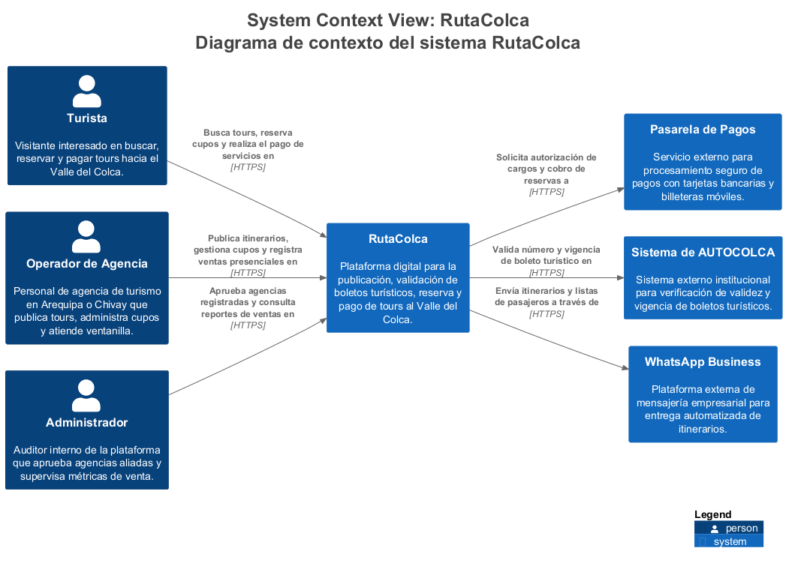
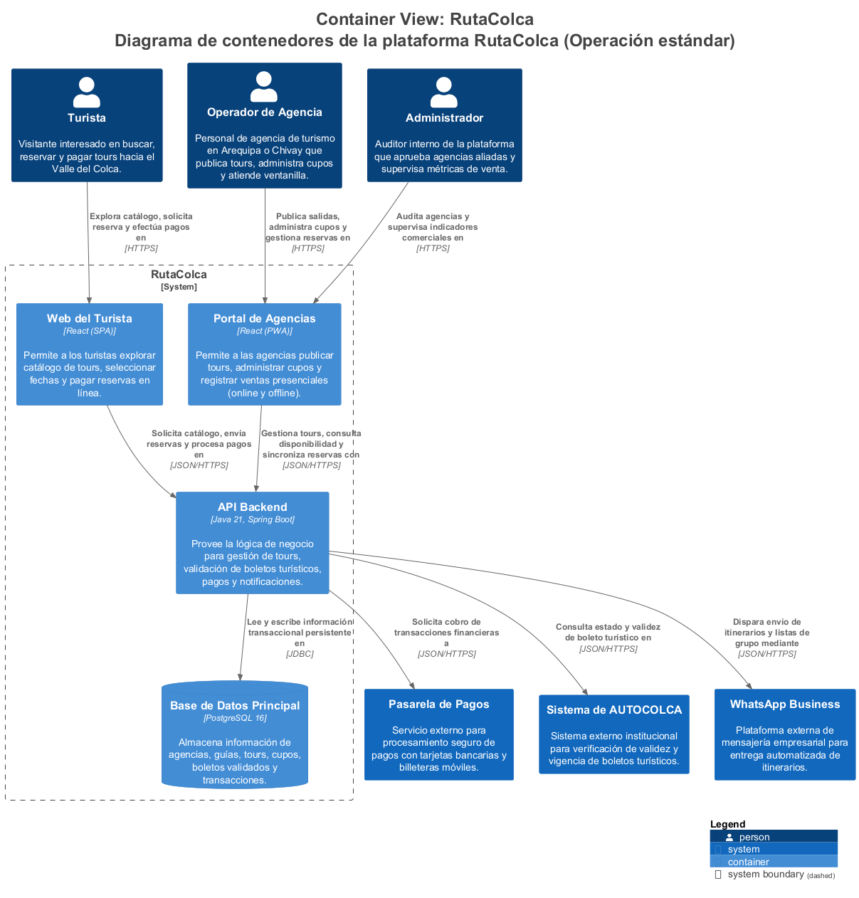
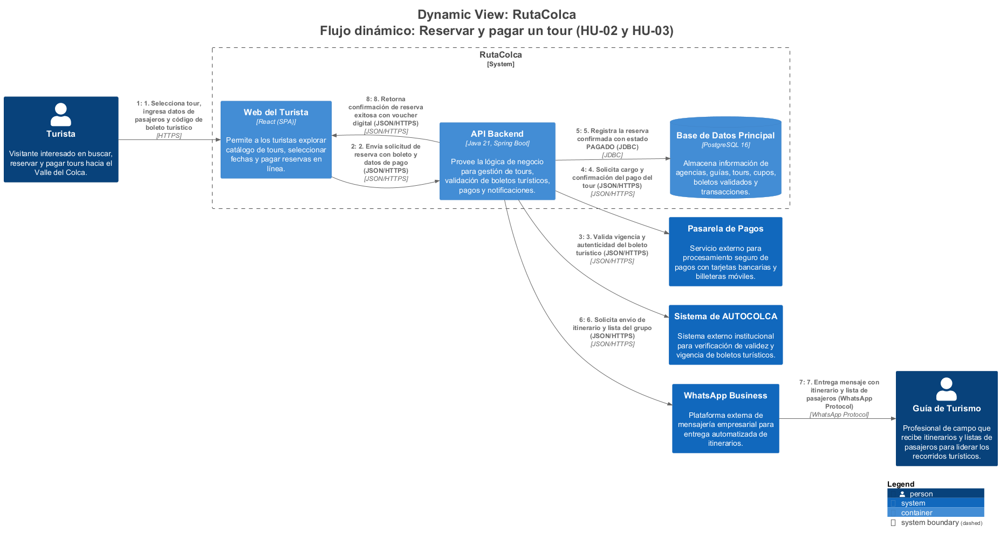
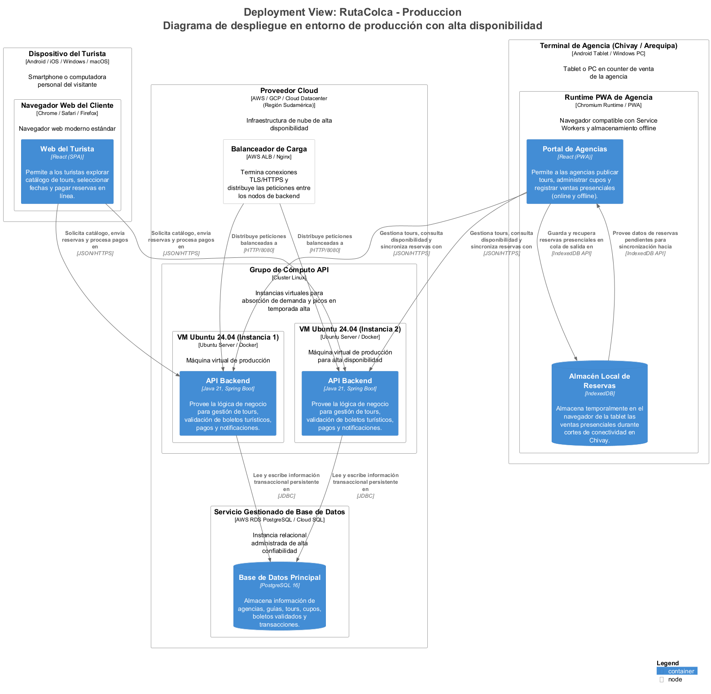
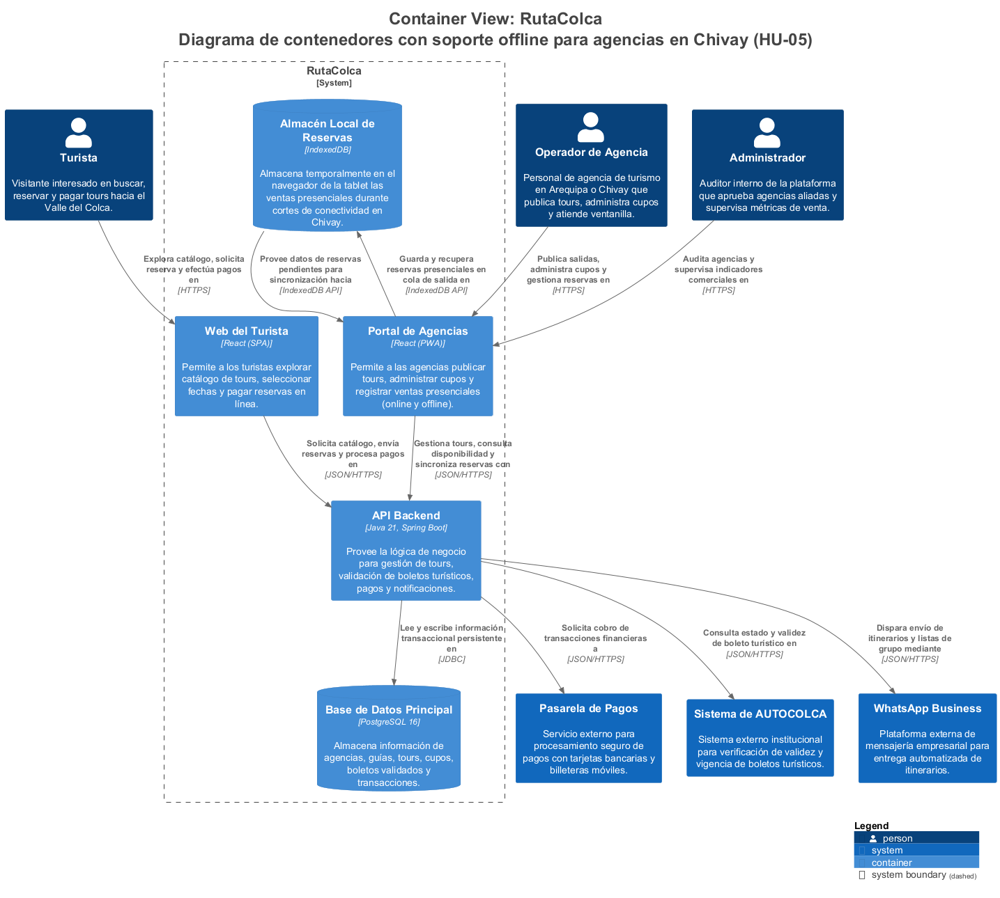

# INFORME TÉCNICO DE ARQUITECTURA DE SOFTWARE
## Caso Práctico Grupal AG-08: Modelado C4 Integral de la Plataforma «RutaColca»
### Contexto, Contenedores, Dinámico, Reto Offline y Despliegue en Producción

---

**UNIVERSIDAD NACIONAL DE SAN AGUSTÍN DE AREQUIPA**  
**Facultad de Ingeniería de Producción y Servicios**  
**Escuela Profesional de Ingeniería de Sistemas**  

* **Asignatura:** Construcción de Software (Código: 1703243) — Semestre 2026-B
* **Tema Académico:** Tema 08: Modelo C4 (Abstracciones, Diagramas como Código y Verificación)
* **Docente:** Mg. Antonio Arroyo Paz (`aarroyop@unsa.edu.pe`)
* **Competencias ABET:** C.c (Diseño con restricciones realistas) · C.d (Trabajo en equipo) · C.g (Comunicación efectiva)
* **Repositorio Oficial:** [https://github.com/leonardobaca7/rutaColca_C4.git](https://github.com/leonardobaca7/rutaColca_C4.git)
* **Fecha:** Arequipa, Octubre de 2026

---

### Equipo de Trabajo y Asignación de Roles

Conforme a la directiva de la práctica, los roles rotaron entre la Parte A (modelado en clase) y la Parte B (extensión y reto offline) para garantizar la participación activa de todos los integrantes en el diseño arquitectónico y en la redacción de código en Structurizr DSL:

| Estudiante | Correo Institucional | Rol Parte A (Clase) | Rol Parte B (Extensión) | Entregable Principal |
| :--- | :--- | :--- | :--- | :--- |
| **Emanuel Hilacondo Begazo** | `ehilacondob@unsa.edu.pe` | **Modelador** | **Revisor** | Inventario C4 (`inventario.md`) y auditoría de rúbrica |
| **Leonardo Juan José Baca Calsin** | `lbacac@unsa.edu.pe` | **Redactor del DSL** | **Vocero / Líder** | Modelo C4 base (`workspace.dsl`), validación CLI y bitácora |
| **Mauro Snayder Sullca Mamani** | `msullcam@unsa.edu.pe` | **Revisor** | **Redactor del DSL** | Matriz de revisión cruzada, entorno de despliegue y exportaciones |
| **German Arturo Chipana Jeronimo** | `gchipanaj@unsa.edu.pe` | **Vocero** | **Modelador** | Explicación no técnica a gerencia y diseño de persistencia offline (`ADR-002`) |

---

## Resumen Ejecutivo

El presente informe documenta el diseño, modelado, verificación formal y despliegue de la plataforma tecnológica «RutaColca», desarrollada para solucionar los problemas críticos de coordinación, sobreventa y comercialización digital de tours que enfrentan las agencias turísticas en Arequipa y el Valle del Colca (Chivay). Adoptando el modelo C4 formulado por Simon Brown y la filosofía de Diagramas como Código (DaC) mediante Structurizr DSL, el equipo elaboró una arquitectura orientada al negocio que articula cuatro niveles de abstracción: Contexto del Sistema, Contenedores Lógicos, Dinámico de Colaboración y Topología de Despliegue en Producción.

Entre los logros más destacados de esta intervención técnica se encuentran: (1) la resolución arquitectónica del reto de conectividad intermitente en Chivay mediante una arquitectura Offline-First con IndexedDB en un portal PWA y una política de partición de cupos que erradica el overbooking; (2) la orquestación temporal que antepone la validación digital de boletos con AUTOCOLCA antes de efectuar cargos bancarios; (3) la validación formal con cero errores sintácticos mediante Structurizr CLI y la compilación multiformato a C4-PlantUML y Mermaid; y (4) la adopción estricta de una gobernanza de Inteligencia Artificial trazable, en la cual la IA propuso código y el equipo aplicó criterios de ingeniería para rechazar componentes innecesarios (Kubernetes, Kafka, Redis), logrando un modelo realista y ejecutable en el plazo perentorio de 1 mes.

---

## 1. Introducción y Contexto del Caso RutaColca

El Valle del Colca es uno de los destinos turísticos más emblemáticos de la región sur del Perú, recibiendo cientos de miles de visitantes nacionales e internacionales cada año. Sin embargo, la cadena de valor de las agencias de viajes de Arequipa y Chivay opera históricamente bajo un esquema tradicional fragmentado: reservas manuales por llamadas telefónicas, mensajería no estructurada en redes sociales y anotaciones físicas en cuadernos. Esta falta de integración ocasiona cuellos de botella severos, cancelaciones de último momento, desinformación hacia los guías de campo y pérdidas económicas por boletos turísticos no validados.

Para responder a esta problemática, un consorcio de agencias solicitó el diseño arquitectónico de **RutaColca**: una plataforma que integre la publicación de salidas, la reserva y pago en línea por turistas, la verificación electrónica de boletos turísticos con el ente regulador AUTOCOLCA y la notificación automatizada de itinerarios hacia los guías vía WhatsApp Business.

### 1.1. Historias de Usuario del MVP
El alcance de la plataforma se encuentra estructurado en seis Historias de Usuario priorizadas según su impacto en el negocio:

| ID | Historia de Usuario | Prioridad | Complejidad Técnica |
| :---: | :--- | :---: | :--- |
| **HU-01** | Como operador de agencia, quiero publicar un tour con fechas de salida y cupos para venderlo en línea. | **Alta** | CRUD transaccional de cupos |
| **HU-02** | Como turista, quiero reservar una salida y pagarla en línea con tarjeta o billetera móvil para asegurar mi lugar. | **Alta** | Integración con pasarela de pagos |
| **HU-03** | Como turista, quiero registrar el número de mi boleto turístico para validarlo con AUTOCOLCA antes de confirmar. | **Alta** | Consumo de API HTTPS externa |
| **HU-04** | Como guía, quiero recibir por WhatsApp el itinerario y la lista de pasajeros un día antes de la salida. | **Media** | Despacho automatizado vía Webhooks |
| **HU-05** | Como operador en Chivay, quiero registrar reservas presenciales en ventanilla aunque no haya internet. | **Media (Reto)** | PWA Offline-First + Sincronización diferida |
| **HU-06** | Como administrador, quiero aprobar agencias aliadas y supervisar reportes de ventas por mes. | **Baja** | Dashboard de auditoría y métricas |

### 1.2. Restricciones y Decisiones Previas (ADR-001)
El desarrollo del sistema está supeditado a decisiones técnicas obligatorias tomadas previamente por el comité de ingeniería (ADR-001):
* **Plazo y Capacidad:** Entrega del MVP en 1 mes con un equipo de 4 ingenieros, apoyados por asistentes de IA.
* **Web del Turista:** Single Page Application (SPA) construida en React para acceso ágil desde navegadores de escritorio y celulares.
* **Portal de Agencias:** Progressive Web App (PWA) en React, dotada de Service Workers y capacidades de ejecución en cliente.
* **Servicios Backend:** API REST empresarial desarrollada en Java 21 sobre Spring Boot, asegurando tipado estático y robustez.
* **Almacenamiento Central:** Motor relacional PostgreSQL 16 con soporte de integridad transaccional ACID.
* **Despliegue y Aislamiento:** Contenedores Docker desplegados sobre máquinas virtuales en un proveedor cloud.
* **Procesamiento Financiero:** Delegado completamente a una pasarela externa certificada (PCI-DSS); RutaColca no guarda tarjetas.

---

## 2. Inventario Arquitectónico y Clasificación C4

Antes de trazar cualquier diagrama, el equipo clasificó exhaustivamente cada entidad del caso de acuerdo con la jerarquía de abstracciones de Simon Brown: Personas, Sistemas de Software (propios y externos) y Contenedores:

| Elemento del Caso | Tipo C4 Formal | Justificación Arquitectónica |
| :--- | :--- | :--- |
| **Turista** | Persona | Usuario final que busca tours, selecciona fechas, reserva y paga en línea. |
| **Operador de agencia** | Persona | Personal de counter en Arequipa o Chivay que publica itinerarios y gestiona cupos. |
| **Guía de turismo** | Persona | Profesional de campo que recibe listas e itinerarios por mensajería sin entrar a la web. |
| **Administrador** | Persona | Auditor interno que autoriza nuevas agencias y monitorea reportes financieros. |
| **RutaColca** | Sistema de Software (Propio) | Núcleo de software en estudio que centraliza catálogo, reservas, pagos y validación. |
| **Pasarela de pagos** | Sistema de Software (Externo) | Proveedor financiero (Niubiz/Stripe) que procesa pagos con tarjeta y billeteras móviles. |
| **Sistema de AUTOCOLCA** | Sistema de Software (Externo) | Servicio gubernamental externo consultado vía HTTPS para autenticar boletos turísticos. |
| **WhatsApp Business** | Sistema de Software (Externo) | Plataforma de mensajería empresarial para entrega automatizada de manifiestos. |
| **Web del turista** | Contenedor (Aplicación) | Single Page Application (React) para consulta de catálogo, reserva y pago digital. |
| **Portal de agencias** | Contenedor (Aplicación) | Progressive Web App (React PWA) para gestión operativa y ventas con o sin conexión. |
| **API Backend** | Contenedor (Aplicación) | Servicio REST central (Java 21, Spring Boot) que orquesta lógica y datos. |
| **Base de Datos Principal** | Contenedor (Almacén de Datos) | Motor relacional PostgreSQL 16 para persistencia ACID de transacciones. |
| **Almacén Local de Reservas** | Contenedor (Almacén de Datos) | Base de datos IndexedDB en el navegador para registrar ventas offline en Chivay. |

### 2.1. Justificación de Actores y Exclusiones de Diseño
* **Inclusión del Guía de Turismo:** En el estándar C4, una Persona representa cualquier rol humano que recibe valor o interactúa con el ecosistema. Dado que RutaColca envía el itinerario y manifiesto a través de WhatsApp Business hacia el guía, este representa el destinatario final de la operación turística. Omitirlo generaría una visión incompleta del flujo de valor.
* **Exclusión de Docker en Contenedores C4:** Un contenedor C4 es una aplicación ejecutable o un almacén de datos (SPA, API, BD). Docker, las máquinas virtuales o los balanceadores son nodos y mecanismos de infraestructura física/virtual, los cuales pertenecen exclusivamente al Diagrama de Despliegue.

---

## 3. Modelado Arquitectónico (Niveles C4 y Vistas de Apoyo)

### 3.1. Nivel 1 · Diagrama de Contexto del Sistema
El Diagrama de Contexto muestra a RutaColca como una caja negra centralizada delimitada frente a sus cuatro actores humanos y los tres sistemas externos. Todas las relaciones son unidireccionales y se leen como oraciones completas:

### 3.2. Nivel 2 · Diagrama de Contenedores (Operación Estándar)
Al realizar zoom sobre RutaColca, el límite del sistema revela los cuatro contenedores del ADR-001. Las relaciones externas se trasladan al contenedor específico: los usuarios acceden mediante HTTPS a las interfaces React, mientras que las comunicaciones internas y externas se realizan sobre `JSON/HTTPS` o `JDBC` para PostgreSQL:

### 3.3. Diagrama Dinámico · Escenario «Reservar y Pagar un Tour» (HU-02 y HU-03)
Flujo temporal numerado de 8 pasos. Se resolvió la pregunta de diseño fundamental:
> **Decisión:** Se valida el boleto turístico con AUTOCOLCA **antes** de procesar el cobro en la pasarela de pagos.  
> **Justificación:** Si se cobrara primero y el boleto es inválido o vencido, la plataforma incurre en comisiones bancarias irreversibles, contracargos y una pésima experiencia de usuario al tramitar reembolsos manuales.

### 3.4. Diagrama de Despliegue en Producción
Modelado del entorno `Produccion` para soportar picos estacionales (julio, agosto y feriados largos): dispositivos cliente, Balanceador de Carga TLS (`infrastructureNode`), 2 máquinas virtuales Ubuntu 24.04 con Docker para la API y servicio gestionado de PostgreSQL 16:

---

## 4. Resolución del Reto de Negocio: Modo Sin Conexión en Chivay (HU-05) y ADR-002

Para cumplir con la venta en ventanilla durante cortes de energía o internet en Chivay:
1. **Contenedor Nuevo:** Almacén de datos del lado del cliente (`IndexedDB`) dentro de la PWA.
2. **Relación Nueva:** El portal guarda y recupera transacciones locales mediante la API nativa de IndexedDB. La comunicación con la API se convierte en asíncrona mediante Service Workers (Background Sync) al recuperar la señal.
3. **Nodo de Ejecución:** Corre en el dispositivo cliente (`Tablet de Agencia`).
4. **Mitigación de Overbooking:** **Partición de Cupos Garantizados (Quota Partitioning)**: Cada terminal en Chivay recibe una cuota fija de asientos reservados asignada cada mañana. Si las ventas en ventanilla exceden la cuota durante el corte, se registra una «Reserva Provisional» advirtiendo al pasajero de la confirmación formal al recuperar el enlace.

---

## 5. Verificación de Calidad y Revisión Cruzada

Aplicando la lista oficial de Simon Brown (*c4model.com/diagrams/checklist*), se documentaron los siguientes hallazgos y correcciones:

| N.º | Elemento Auditado | Hallazgo Detectado | Severidad | Acción Correctiva Adoptada |
| :---: | :--- | :--- | :---: | :--- |
| **1** | Web Turista -> API | Etiqueta genérica «usa» sin verbo activo ni protocolo. | **Media** | Corregido a: «Solicita catálogo, envía reservas y procesa pagos en» [JSON/HTTPS]. |
| **2** | Diagrama Contenedores | Caja nombrada «Docker Engine» dentro de RutaColca. | **Alta** | Eliminado de contenedores lógicos; reubicado como runtime en despliegue. |
| **3** | Diagrama Contexto | Omisión del Guía de Turismo por «no tener login». | **Media** | Reincorporado como Persona receptora conectada al canal de WhatsApp Business. |
| **4** | Diagrama Dinámico | Flujo cobraba en pasarela antes de validar con AUTOCOLCA. | **Alta** | Reordenado: la validación del boleto es condición previa obligatoria para el débito. |
| **5** | Base de Datos | No indicaba la versión específica del motor relacional. | **Baja** | Actualizado con la especificación técnica exacta del ADR-001: PostgreSQL 16. |

---

## 6. Comunicación Ejecutiva hacia Stakeholders No Técnicos

Discurso de 118 palabras diseñado para doña Rosa, gerente de agencia en Chivay (sin siglas ni tecnicismos):

> *«Buenos días, doña Rosa. Sabemos lo difícil que es hoy coordinar tours llamando por teléfono, anotando pasajeros en cuadernos y mandando mensajes sueltos cuando la señal falla aquí en Chivay. Con RutaColca, su agencia podrá publicar directamente sus salidas hacia la Cruz del Cóndor o los trekkings del cañón, indicando cuántos asientos libres tiene cada día. Los turistas eligen su tour por internet y pagan en el acto desde su teléfono o tarjeta. Antes de confirmar, la plataforma verifica al instante que el boleto turístico de AUTOCOLCA sea válido para que usted no tenga problemas en el control de entrada. Finalmente, sus guías reciben la lista completa de pasajeros e itinerario directamente en su WhatsApp un día antes. Así su agencia ahorra tiempo, evita cancelaciones de último momento y no pierde ninguna venta, incluso si se corta el internet en ventanilla».*

---

## 7. Trazabilidad del Uso de Inteligencia Artificial (Bitácora AG-08)

| P# | Prompt Utilizado | Propuesta Aceptada | Propuesta Rechazada o Corregida | Responsable |
| :---: | :--- | :--- | :--- | :--- |
| **P1** | Revisión de inventario | Clasificación de turistas, operadores y sistemas externos. | Rechazado incluir Docker como contenedor C4. | Emanuel Hilacondo Begazo |
| **P2** | Contexto Structurizr DSL | Estructura del bloque model con identificadores jerárquicos. | Reemplazada la palabra genérica «usa» por oraciones descriptivas. | Leonardo Baca Calsin |
| **P3** | Contenedores según ADR-001 | Descomposición en React SPA, React PWA, Spring Boot y Postgres. | Rechazada sugerencia de añadir Kafka y Redis (excedía el MVP). | Mauro Sullca Mamani |
| **P4** | Dinámico de reserva y pago | Estructura sintáctica del bloque dynamic y numeración. | Invertido el orden: validar con AUTOCOLCA antes de cobrar. | Leonardo Baca Calsin |
| **P5** | Auditoría C4 cruzada | Matriz de verificación formal basada en Simon Brown. | Desestimada queja sobre ausencia de componentes (no aplicaba al lab). | Mauro Sullca Mamani |
| **P6** | Explicación no técnica | Metáfora de negocio orientada a la venta de tours en ventanilla. | Eliminadas siglas técnicas (PWA, API, SSL); ajustado a 118 palabras. | German Chipana Jeronimo |
| **P7** | Despliegue en producción | Jerarquía de deploymentNode e infrastructureNode de balanceador. | Corregida sintaxis de containerInstance jerárquico. | Mauro Sullca Mamani |
| **P8** | Impacto del reto offline | Cuestionario de 5 preguntas sobre concurrencia e idempotencia. | Descartada sincronización P2P compleja; adoptada partición de cupos. | German Chipana Jeronimo |

---

## 8. Respuestas Argumentadas para la Sustentación Oral

1. **¿Por qué RutaColca aparece como una sola caja en el contexto y como un límite con varios contenedores en el siguiente nivel?**  
   Porque responden a propósitos y audiencias totalmente distintas. El diagrama de contexto oculta la complejidad interna para que cualquier interesado (ej. gerentes de agencias o directivos de turismo) comprenda el alcance de negocio y con qué servicios se comunica. El diagrama de contenedores hace un 'zoom in' técnico para los ingenieros de desarrollo y operaciones, mostrando la arquitectura de software ejecutable (SPA, PWA, API REST) y almacenes de datos donde residirá la solución.
2. **¿Qué diagrama le mostrarían a la gerente de una agencia y cuál al equipo de operaciones? ¿Por qué?**  
   A la gerente de la agencia le mostraríamos el Diagrama de Contexto (Nivel 1), ya que explica con claridad cómo su negocio interactúa con la plataforma sin confundirla con tecnologías de desarrollo. Al equipo de operaciones le mostraríamos el Diagrama de Despliegue, ya que especifica los balanceadores de carga TLS, el número de máquinas virtuales para la API en temporada alta y la base de datos gestionada.
3. **¿Qué propuesta de la IA rechazaron y qué regla de C4 usaron para hacerlo?**  
   Rechazamos la propuesta de la IA de modelar a Docker como un contenedor C4 dentro del límite del sistema, y la recomendación de incorporar Apache Kafka y Redis. Aplicamos la regla canónica de Simon Brown: *«un contenedor C4 es una aplicación o almacén de datos propio, no una tecnología de virtualización ni de infraestructura de servidores»*; además de ceñirnos al principio YAGNI y a la restricción del MVP (1 mes).
4. **¿Qué cambió en su modelo al resolver el reto sin conexión y en qué diagramas se nota?**  
   En el modelo se incorporó un nuevo contenedor de datos: «Almacén Local de Reservas» (IndexedDB) asociado al Portal PWA y relaciones de sincronización asíncrona por lotes. Esto se evidencia de forma explícita en la nueva vista de contenedores (`ContenedoresReto`) y en el Diagrama de Despliegue, donde dicho almacén figura instanciado dentro del nodo cliente (Tablet de Agencia).

---

## 9. Conclusiones y Referencias Bibliográficas

1. **Rigor metodológico:** Structurizr DSL garantiza la consistencia del modelo. Al tratar la arquitectura como código, cualquier cambio se propaga de forma coherente a todas las vistas sin riesgo de desincronización gráfica.
2. **Alineación técnica y de negocio:** La anticipación de la validación de boletos turísticos frente al cobro financiero demuestra que las decisiones arquitectónicas impactan directamente en la viabilidad económica y operativa del proyecto.
3. **Resiliencia en entornos hostiles:** La combinación de PWA con IndexedDB y partición de cupos resuelve el problema real de las agencias de Chivay, garantizando continuidad comercial sin comprometer la integridad de la base central.

### Referencias Bibliográficas (Norma APA 7ma Edición)
* Bass, L., Clements, P., & Kazman, R. (2021). *Software architecture in practice* (4th ed.). Addison-Wesley.
* Brown, S. (2026). *The C4 model for visualising software architecture*. O’Reilly Media / c4model.com.
* ISO/IEC/IEEE. (2022). *ISO/IEC/IEEE 42010:2022 Software, systems and enterprise — Architecture description*. International Organization for Standardization.
* Structurizr. (2026). *Structurizr DSL: Language reference and open source command line interface*. docs.structurizr.com.
