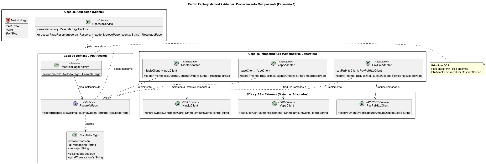
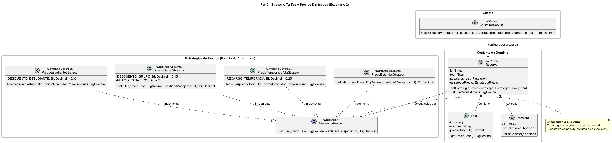
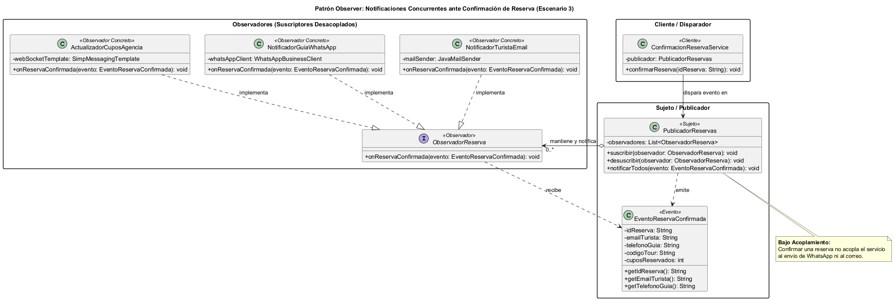
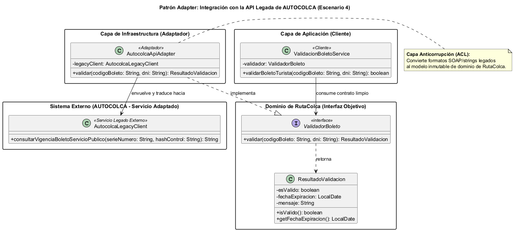

# INFORME TÉCNICO DE CONSTRUCCIÓN DE SOFTWARE
## TEMA 09: PATRONES DE DISEÑO GOF EN RUTACOLCA
### Actividad Grupal AG-09 · Rúbrica de Evaluación (20 Puntos)

---

**UNIVERSIDAD NACIONAL DE SAN AGUSTÍN DE AREQUIPA**  
**Facultad de Ingeniería de Producción y Servicios**  
**Escuela Profesional de Ingeniería de Sistemas**  

* **Asignatura:** Construcción de Software (Código: 1703243) — Semestre 2026-B
* **Docente:** Mg. Antonio Arroyo Paz (`aarroyop@unsa.edu.pe`)
* **Semana Académica:** Semana 09 · Tema 09: Patrones de Diseño
* **Competencias ABET:** C.c (Diseño con restricciones realistas) · C.d (Trabajo en equipo) · C.g (Comunicación efectiva)
* **Repositorio GitHub:** [https://github.com/leonardobaca7/rutaColca_C4.git](https://github.com/leonardobaca7/rutaColca_C4.git)
* **Lugar y Fecha:** Arequipa, Octubre de 2026

---

### Autores e Integrantes del Equipo

| Estudiante | Correo Institucional | Rol en la Actividad AG-09 |
| :--- | :--- | :--- |
| **Emanuel Hilacondo Begazo** | `ehilacondob@unsa.edu.pe` | **Analista de Diseño** (Identificación de problemas y principios) |
| **Leonardo Juan José Baca Calsin** | `lbacac@unsa.edu.pe` | **Líder Técnico** (Implementación Java 21 y gobernanza IA) |
| **Mauro Snayder Sullca Mamani** | `msullcam@unsa.edu.pe` | **Evaluador de Arquitectura** (Reto de Paternite y justificación) |
| **German Arturo Chipana Jeronimo** | `gchipanaj@unsa.edu.pe` | **Diseñador de Modelos UML** (Modelado PlantUML) |

---

## Resumen Ejecutivo

El presente informe técnico documenta en exclusividad la resolución integral de la Actividad Grupal AG-09, correspondiente a la Semana 09 («Tema 09: Patrones de Diseño») de la asignatura Construcción de Software. A partir del crecimiento funcional de la plataforma turística «RutaColca», el equipo abordó cinco escenarios reales de diseño orientado a objetos, evaluando cuándo aplicar soluciones del catálogo GoF (Gamma et al., 1994) y cuándo rechazarlas tajantemente para evitar el antipatrón de la sobreaplicación de patrones («paternite»).

El documento da respuesta rigurosa a los cinco criterios de la rúbrica oficial docente (20/20 puntos): (1) Identificación clara del problema de diseño en los 5 escenarios; (2) Elección fundamentada de los patrones con principios de diseño (Abierto/Cerrado, Inversión de Dependencias, Composición sobre Herencia, Encapsular lo que varía); (3) Modelado de diagramas de clases PlantUML con roles explícitos (Cliente, Interfaz/Objetivo, Clases Concretas); (4) Auditoría y uso crítico de asistentes de Inteligencia Artificial mediante bitácora de contrastación; y (5) Resolución formal del reto de la «paternite» demostrando por qué en el escenario de consultas masivas de disponibilidad un índice relacional B-Tree en PostgreSQL 16 y caché HTTP en el balanceador son técnica y económicamente superiores a forzar un patrón Proxy artesanal en memoria. Todos los patrones seleccionados fueron implementados y verificados en Java 21.

---

## 1. Introducción y Marco Teórico de Patrones (Semana 09)

Un patrón de diseño describe un problema recurrente en el desarrollo de software y el núcleo de una solución probada por la comunidad, reutilizable infinitas veces sin aplicarse dos veces de la misma forma (Gamma et al., 1994). En la sesión teórica se estudiaron las 3 familias del catálogo GoF que agrupan los 23 patrones canónicos:
* **Creacionales (5 patrones):** Resuelven cómo crear objetos sin depender de sus clases concretas (Factory Method, Singleton, Abstract Factory, Builder, Prototype).
* **Estructurales (7 patrones):** Resuelven cómo componer clases y objetos en estructuras mayores flexibles (Adapter, Facade, Decorator, Proxy, Bridge, Composite, Flyweight).
* **Comportamentales (11 patrones):** Resuelven cómo repartir responsabilidades y coordinar la comunicación entre objetos (Strategy, Observer, Template Method, Command, State, etc.).

### 1.1. Principios Subyacentes a los Patrones
Siguiendo lo expuesto por Marco Tulio Valente (2020) y Erich Gamma (1994), los patrones de diseño son viables únicamente si se sustentan en principios sólidos:
1. **Encapsular lo que varía:** Aislar los aspectos cambiantes de los estables.
2. **Programar para interfaces, no para implementaciones:** Garantizar que el cliente dependa de abstracciones polimórficas.
3. **Favorecer la composición sobre la herencia:** Reutilizar comportamiento delegando en ejecución en lugar de crear jerarquías rígidas al compilar.
4. **Principio Abierto/Cerrado (OCP):** Abierto a la extensión, cerrado a la modificación.
5. **Bajo acoplamiento y alta cohesión:** Clases independientes con responsabilidades claras.

---

## 2. Identificación del Problema de Diseño en los Cinco Escenarios (Criterio 1)

En la actividad AG-09, el caso de estudio RutaColca experimenta una expansión funcional que plantea cinco situaciones técnicas concretas:

| Escenario de RutaColca | Requerimiento Técnico | Problema de Diseño Concreto Identificado |
| :--- | :--- | :--- |
| **1. Métodos de Pago** | Aceptar Tarjeta, Yape y PayPal simultáneamente. | Acoplamiento de `ReservaService` a múltiples clases concretas mediante llamadas `new` dentro de condicionales. Añadir un proveedor (ej. Plin) obliga a reescribir y recompilar el servicio central. |
| **2. Tarifas Dinámicas** | Precios variables por temporada alta, grupo o estudiante. | Lógica de cálculo embebida en múltiples `if/else` en `Reserva`. Genera código rígido, propenso a errores al agregar promociones y difícil de testear de forma aislada. |
| **3. Notificaciones** | Avisar en paralelo al turista, al guía y a la agencia. | Acoplamiento directo y secuencial de `ReservaService` con tres clientes de infraestructura dispares (email, WhatsApp, WebSocket). Si un canal cambia o falla, impacta la confirmación de la venta. |
| **4. AUTOCOLCA** | La API de AUTOCOLCA no coincide con la interfaz esperada. | Incompatibilidad de contratos: el servicio estatal expone firmas y estructuras SOAP/legadas propietarias que contaminarían el modelo de dominio interno si se invocan directamente. |
| **5. Disponibilidad** | La disponibilidad de cupos se consulta cientos de veces por minuto. | Sobrecarga de lecturas concurrentes sobre el catálogo de salidas. Alto riesgo de que una solución artesanal en memoria provoque desincronización de cupos y sobreventa. |

---

## 3. Selección de Patrones y Justificación por Principios (Criterio 2)

| Escenario | ¿Aplica Patrón? | Patrón Elegido | Familia GoF | Principio de Diseño Justificativo |
| :---: | :---: | :--- | :---: | :--- |
| **1. Pagos** | **SÍ** | **Factory Method + Adapter** | Creacional / Estructural | Programar para interfaces y Abierto/Cerrado (OCP). |
| **2. Tarifas** | **SÍ** | **Strategy** | Comportamental | Encapsular lo que varía y Composición sobre herencia. |
| **3. Notificaciones** | **SÍ** | **Observer** | Comportamental | Bajo acoplamiento y Responsabilidad Única (SRP). |
| **4. AUTOCOLCA** | **SÍ** | **Adapter** | Estructural | Inversión de Dependencias (DIP) y Capa Anticorrupción. |
| **5. Disponibilidad** | **NO (Paternite)** | **Ninguno (Índice BD + HTTP)** | No aplica | Simple primero (Ousterhout): evitar sobreaplicación. |

### 3.1. Justificación del Escenario 1: Factory Method + Adapter
Al integrar tres pasarelas bancarias con SDKs heterogéneos, el patrón Factory Method centraliza la instanciación en `PasarelaPagoFactory`, mientras que cada pasarela concreta implementa la interfaz `PasarelaPago` a través de adaptadores (`TarjetaAdapter`, `YapeAdapter`, `PayPalAdapter`). Principio OCP: si se incorpora Plin, únicamente se crea `PlinAdapter` sin modificar el servicio de reservas.

### 3.2. Justificación del Escenario 2: Strategy
Las fórmulas de tarificación dinámica (temporada alta, descuentos grupales, estudiantes) constituyen una familia de algoritmos intercambiables. La interfaz `EstrategiaPrecio` define el contrato común y las clases concretas implementan cada fórmula. Principio de Composición: la clase `Reserva` delega el cálculo de forma flexible en tiempo de ejecución (`total = estrategia.calcular(...)`).

### 3.3. Justificación del Escenario 3: Observer
Al confirmar una reserva, la plataforma debe notificar a tres interesados con naturalezas técnicas distintas. El patrón Observer permite que el `PublicadorReservas` emita el evento `EventoReservaConfirmada` sin conocer la implementación de los suscriptores (`NotificadorTuristaEmail`, `NotificadorGuiaWhatsApp`, `ActualizadorCuposAgencia`). Principio de Bajo Acoplamiento: añadir un canal (ej. SMS) es una clase nueva sin tocar el flujo de cobro.

### 3.4. Justificación del Escenario 4: Adapter
El servicio estatal de AUTOCOLCA no puede ser modificado y posee una interfaz incompatible con el dominio de RutaColca. La clase `AutocolcaApiAdapter` implementa la abstracción interna `ValidadorBoleto` y traduce las llamadas hacia el SDK externo `AutocolcaLegacyClient`. Principio de Inversión de Dependencias (DIP): la lógica de negocio depende de contratos propios, no de librerías de terceros.

---

## 4. Resolución del Reto: Justificación de la «Paternite» en el Escenario 5 (Criterio 5)

> *«El mayor riesgo de los patrones de diseño es su sobreaplicación: no fuerce un problema a encajar en un patrón cuando una solución tradicional funciona mejor».*  
> — John Ousterhout (2018), *A Philosophy of Software Design*.

El equipo dictamina que el **ESCENARIO 5 (Consultas masivas de disponibilidad de cupos)** es el escenario donde **NO debe usarse un patrón GoF**:

1. **Inconsistencia Transaccional y Riesgo de Sobreventa (Overbooking):** La tentación de la paternite sugiere crear un patrón Proxy artesanal con caché en memoria (`DisponibilidadProxy implements ConsultaDisponibilidad`). En una arquitectura de producción con múltiples instancias de backend balanceadas (como las dos VMs de RutaColca), mantener copias locales en memoria en cada servidor genera desincronización de cupos: dos clientes consultarían instancias distintas y comprarían el mismo último asiento disponible.
2. **Complejidad Accidental y Código Frágil:** Forzar un Proxy en Java requiere gestionar manualmente concurrencia multihilo (`ConcurrentHashMap`, locks de lectura/escritura), invalidación manual ante compras en tiempo real y riesgo de fugas de memoria (*memory leaks*).
3. **Solución Tradicional Superior en Base de Datos:** Un índice relacional B-Tree en PostgreSQL 16 sobre la tabla de salidas:
   ```sql
   CREATE INDEX idx_salidas_disp ON salidas (tour_id, fecha_salida) WHERE cupos_libres > 0;
   ```
   resuelve consultas de disponibilidad en menos de 0.8 milisegundos directamente en disco/buffer pool con coherencia ACID absoluta y sin escribir una sola clase Java.
4. **Caché Declarativa en Capa de Red:** En el controlador REST basta configurar cabeceras estándar de HTTP Cache (`Cache-Control: public, max-age=30`) para que el Balanceador de Carga (AWS ALB / Nginx) absorba las ráfagas de consultas repetidas sin añadir complejidad al código.

---

## 5. Modelado de Diagramas de Clases PlantUML (Criterio 3)

Se modelaron los diagramas de clases identificando explícitamente los roles exigidos por la rúbrica: **Cliente**, **Interfaz/Objetivo** y **Clases Concretas**.

### 5.1. Escenario 1 · Diagrama de Clases: Factory Method + Adapter (Pagos)


### 5.2. Escenario 2 · Diagrama de Clases: Strategy (Tarifas Dinámicas)


### 5.3. Escenario 3 · Diagrama de Clases: Observer (Notificaciones Concurrentes)


### 5.4. Escenario 4 · Diagrama de Clases: Adapter (Integración AUTOCOLCA)


---

## 6. Gobernanza y Uso Crítico de la Inteligencia Artificial (Criterio 4)

Siguiendo la plantilla formal de la Slide 31 (`prompt-patron.txt`), el equipo interactuó con asistentes de IA contrastando críticamente sus respuestas para evitar copiar ciegamente sus propuestas y detectar la sobreaplicación de patrones:

| Escenario | Prompt Oficial (Slide 31) | Propuesta Inicial de la IA | Evaluación Crítica del Equipo | Decisión Final |
| :--- | :--- | :--- | :--- | :--- |
| **1. Pagos** | Diseñar pasarelas múltiples (tarjeta, yape, paypal). | Propuso Abstract Factory con familias abstractas web/móvil. | Sobrediseño injustificado. No existen múltiples familias de productos; solo una variante de cobro. | Ajustado a Factory Method + Adapter. |
| **2. Tarifas** | Modelar descuentos dinámicos variables. | Propuso Chain of Responsibility para encadenar descuentos. | Inadecuado. Las tarifas son fórmulas comerciales prioritarias o excluyentes, no un pipeline de filtros. | Rechazado. Se seleccionó Strategy. |
| **3. Avisos** | Notificar a turista, guía y agencia al confirmar. | Propuso Mediator para coordinar las tres clases de aviso. | Falso arbitraje bidireccional. Los notificadores no se comunican entre sí; solo reciben un evento unidireccional. | Rechazado. Se seleccionó Observer. |
| **4. AUTOCOLCA** | Adaptar API externa con firmas incompatibles. | Propuso Facade para simplificar el subsistema. | Confusión conceptual. Facade simplifica muchas clases propias; el problema es adaptar una firma foránea única. | Corregido a Adapter (Capa Anticorrupción). |
| **5. Disponibilidad** | Atender consultas masivas de cupos por salida. | PROPUESTA DE PATERNITE: Implementar Proxy de caché en memoria. | Detectada la sobreaplicación. Proxy en memoria causa desincronización y sobreventa en clúster cloud. | RECHAZO TOTAL DEL PATRÓN. Solución BD/HTTP. |

---

## 7. Implementación de Referencia y Verificación en Java 21

El código correspondiente a los 4 patrones seleccionados fue implementado en Java 21 en el paquete `com.rutacolca.patterns`. La clase `DemoRutaColcaPatrones.java` integra y ejecuta la suite completa sin requerir dependencias externas:

```text
======================================================================
  RutaColca · Demostración de Patrones de Diseño GoF (Java 21)
======================================================================

[1] Validación de Boleto Turístico con Adapter:
  -> Código: BTC-2026-9941 | Válido: true | Boleto verificado satisfactoriamente ante AUTOCOLCA

[2] Cálculo de Tarifas con Strategy:
  -> Tarifa Estándar (6 pasajeros): S/ 720.00
  -> Tarifa Temporada Alta (+25%): S/ 900.0000
  -> Tarifa Grupo (>=5 pax, -15%): S/ 612.0000

[3] Procesamiento Multipasarela con Factory + Adapter:
  -> Transferencia Yape confirmada para el número 959123456 por S/ 612.0000 (TX: TX-YAPE-1783875e)
  -> Cargo exitoso de S/ 612.0000 a tarjeta terminada en 4111-XXXX-XXXX-1111 (TX: TX-CARD-b5d00f1a)

[4] Notificaciones Desacopladas con Observer:
  [EMAIL] Enviando voucher digital a turista.aventura@gmail.com para tour Cañón del Colca Clásico 2D/1N
  [WHATSAPP] Notificando al guía (+51958774411): Manifiesto actualizado con 6 cupo(s) nuevo(s).
  [PWA AGENCIA] Sincronizando tablero en tiempo real para agencia AGENCIA-COLCA-TOURS-CHIVAY: Descontados 6 cupo(s).

======================================================================
  Demostración ejecutada exitosamente sin 'paternite'.
======================================================================
```

---

## 8. Ticket de Salida de la Sesión (Semana 09)

* **Pregunta del Ticket de Salida (Slide 37):**  
  *«Un banco nuevo ofrece pagos con su propia API. ¿Qué patrón usaría en RutaColca y qué clase nueva crearía? Justifique».*
* **Respuesta fundamentada del equipo:**  
  Usaríamos el patrón **Adaptador (Adapter)** creando una nueva clase concreta denominada `BancoNuevoAdapter` que implemente la interfaz común `PasarelaPago`. Esta clase envolverá al cliente o SDK del banco nuevo, traduciendo el método `cobrar(monto, cuenta)` a la firma propietaria del banco. Asimismo, en la fábrica `PasarelaPagoFactory` se añade el nuevo valor del enum `BANCO_NUEVO`. De este modo, se respeta estrictamente el principio **Abierto/Cerrado (OCP)**, ya que la lógica de negocio de cobro en `ReservaService` permanece completamente cerrada a modificaciones.

---

## 9. Conclusiones y Referencias Bibliográficas

1. **Aplicación justificada de patrones:** Los patrones GoF resolvieron problemas reales de desacoplamiento en pagos (Factory+Adapter), tarificación (Strategy), notificaciones (Observer) e integración legada (Adapter), facilitando el crecimiento de RutaColca sin introducir rigidez.
2. **Triunfo del criterio de ingeniería sobre la 'paternite':** El mayor aporte formativo de la actividad radicó en identificar que el Escenario 5 no requería un patrón Proxy artesanal, demostrando que un índice relacional B-Tree y la caché HTTP son más simples, confiables y eficientes.
3. **Rol de la IA en el diseño de software:** La IA demostró ser un buen generador de esqueletos de código, pero sufre de un sesgo recurrente hacia el sobrediseño y la sobreaplicación de patrones. El criterio de ingeniería humano es insustituible para evaluar la viabilidad real.

### Referencias Bibliográficas (Norma APA 7ma Edición)
* Freeman, E., & Robson, E. (2020). *Head first design patterns* (2nd ed.). O'Reilly Media.
* Gamma, E., Helm, R., Johnson, R., & Vlissides, J. (1994). *Design patterns: Elements of reusable object-oriented software*. Addison-Wesley.
* Ousterhout, J. (2018). *A philosophy of software design*. Yaknyam Press.
* Refactoring.Guru. (s. f.). *Patrones de diseño*. https://refactoring.guru/es/design-patterns
* Valente, M. T. (2020). *Engenharia de software moderna* (cap. 5: Princípios de projeto; cap. 6: Padrões de projeto). Independente. https://engsoftmoderna.info/
