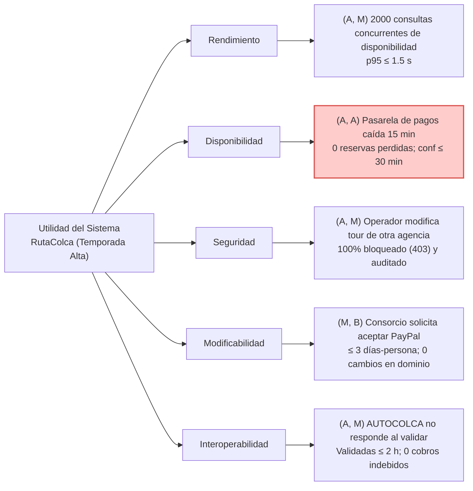

# INFORME TÉCNICO DE LABORATORIO AG-10
## DISEÑO DE LA ARQUITECTURA DE RUTACOLCA
### Una Iteración de ADD 3.0 para la Temporada Alta en el Valle del Colca

---

**UNIVERSIDAD NACIONAL DE SAN AGUSTÍN DE AREQUIPA**  
**FACULTAD DE INGENIERÍA DE PRODUCCIÓN Y SERVICIOS**  
**ESCUELA PROFESIONAL DE INGENIERÍA DE SISTEMAS**  
*Acreditación ABET – Formación en Ingeniería de Software de Clase Mundial*

- **Asignatura:** Construcción de Software (1703243) – Semestre 2026-B
- **Tema Académico:** Tema 10: Diseño de la Arquitectura (Semana 10)
- **Docente:** Mg. Antonio Arroyo Paz (`aarroyop@unsa.edu.pe`)
- **Grupo:** Grupo 2 – Escenario Asignado E2: Disponibilidad (Pasarela de Pagos Caída)
- **Integrantes y Roles:**
  - **Emanuel Hilacondo Begazo** (`ehilacondob@unsa.edu.pe`) – Facilitador ADD
  - **German Arturo Chipana Jeronimo** (`gchipanaj@unsa.edu.pe`) – Arquitecto
  - **Leonardo Juan José Baca Calsin** (`lbacac@unsa.edu.pe`) – Redactor
  - **Mauro Snayder Sullca Mamani** (`msullcam@unsa.edu.pe`) – Evaluador ATAM
- **Repositorio Oficial:** [github.com/leonardobaca7/rutaColca_C4](https://github.com/leonardobaca7/rutaColca_C4)
- **Arequipa, Perú – Octubre de 2026**

---

## Resumen Ejecutivo

El presente informe documenta la solución integral del Caso Práctico Grupal AG-10 para la asignatura Construcción de Software. El objetivo consistió en diseñar una iteración de arquitectura de software para la plataforma RutaColca bajo el contexto de alta demanda en temporada alta (julio/agosto), donde las reservas se multiplican por diez y los servicios bancarios externos sufren interrupciones periódicas. Empleando el método formal **Attribute-Driven Design (ADD 3.0)**, las tácticas de disponibilidad de Bass et al. (2021) y una evaluación ligera inspirada en ATAM, el equipo priorizó los atributos de calidad del sistema y seleccionó el **Escenario E2 (Disponibilidad: caída de pasarela de pagos por 15 minutos)** como el de mayor concentración de riesgo crítico (A, A).

Para resolver el escenario sin infringir la restricción obligatoria de mantener el **Monolito Modular (ADR-001)** ni incurrir en costos de infraestructura injustificados, se contrastaron formalmente dos alternativas. Se descartó la adopción de un broker distribuido externo (RabbitMQ/Kafka) por sobrecostos operativos (+120 USD/mes) y complejidad de entrega en 3 semanas, adoptando el **Patrón Outbox Transaccional** sobre PostgreSQL 16 acoplado a un **Circuit Breaker** (Resilience4j) en Spring Boot 3 con *Virtual Threads* de Java 21. La decisión se formalizó en el **ADR-003**, el modelo C4 se enriqueció con una vista dinámica exportada, se implementó una prueba de concepto en Java 21 con 100% de conciliación exitosa bajo fallo simulado, y se ejecutó la evaluación cruzada ATAM sobre el escenario de seguridad (E3 / BOLA).

---

## 1. Contexto Operativo y Drivers de Arquitectura

RutaColca afronta la llegada de la temporada alta de turismo (julio/agosto). La demanda de reservas experimenta un incremento de un orden de magnitud ($\times 10$), las pasarelas bancarias sufren caídas de hasta 15 minutos continuos, el servicio de verificación de AUTOCOLCA colapsa en horas pico, se registran intentos de manipulación de tours ajenos entre agencias competidoras y el consorcio solicita admitir PayPal para turistas extranjeros.

### Drivers de la Iteración:
- **Propósito:** Evolucionar la arquitectura existente sin rehacer el sistema desde cero.
- **Restricción Arquitectónica ([ADR-001](file:///docs/architecture/adr/ADR-001.md)):** Preservar el Monolito Modular en Java 21 / Spring Boot 3 y PostgreSQL 16.
- **Restricción de Recursos:** Equipo fijo de 4 desarrolladores con entrega final en 3 semanas.
- **Restricción Financiera:** Cero infraestructura innecesaria; todo nuevo componente debe justificar estrictamente su costo operativo mensual.
- **Preocupaciones Transversales:** Trazabilidad, pruebas automatizadas y despliegue continuo sin interrupción de ventas.

---

## 2. Paso 1: Árbol de Utilidad y Priorización de Escenarios

Siguiendo las directrices de ATAM (Kazman et al., 2000), el facilitador ADD lideró la calificación de los cinco escenarios de calidad evaluando su Importancia para el Negocio (I) y su Dificultad Técnica Estimada (D) con la arquitectura actual:

| ID | Atributo | Importancia (I) | Dificultad (D) | Justificación Técnica y de Negocio |
| :---: | :---: | :---: | :---: | :--- |
| **E1** | **Rendimiento** | **Alta (A)** | **Media (M)** | 2000 consultas simultáneas saturarían la API; se mitiga con caché en memoria y réplicas. |
| **E2** | **Disponibilidad** | **Alta (A)** | **Alta (A)** | Caída externa de 15 min; arquitectura síncrona causa cobros huérfanos y agotamiento de hilos. |
| **E3** | **Seguridad** | **Alta (A)** | **Media (M)** | Manipulación de tours ajenos; requiere validación estricta de objeto (BOLA) y auditoría sin penalizar latencia. |
| **E4** | **Modificabilidad**| **Media (M)** | **Baja (B)** | Aceptar PayPal en $\le 3$ días-persona se resuelve mediante la infraestructura de adaptadores ya existente. |
| **E5** | **Interoperabilidad**| **Alta (A)** | **Media (M)** | Caída de AUTOCOLCA impide emitir boletos; requiere desacoplamiento temporal y conciliación por lotes. |

---

## 3. Paso 2: Especificación del Escenario E2 en Seis Partes

Conforme al estándar formal de **Bass, Clements y Kazman (2021)**:

| Parte del Escenario | Contenido del Grupo RutaColca | Justificación Técnica |
| :--- | :--- | :--- |
| **1. Fuente del Estímulo** | Pasarela Externa de Pagos Bancarios (Niubiz, Izipay o API de PayPal). | Sistema de terceros fuera del control operativo de la agencia. |
| **2. Estímulo** | Corte del servicio o timeout de red durante hasta 15 minutos continuos (HTTP 504 / SocketTimeout). | Simula la saturación típica de redes bancarias en temporada alta. |
| **3. Artefacto Afectado** | Módulo de Pagos y Reservas en API Backend y tablas transaccionales en PostgreSQL 16. | Componentes internos responsables de orquestar y persistir la transacción. |
| **4. Entorno de Operación** | Operación en temporada alta (pico de carga $\times 10$) con alta concurrencia de turistas. | El sistema no puede apagarse ni entrar en mantenimiento fuera de línea. |
| **5. Respuesta del Sistema** | 1. Circuit Breaker corta llamadas salientes bloqueantes para evitar agotar hilos. 2. La reserva y orden de cobro se insertan atómicamente en PostgreSQL (*Transactional Outbox*) con estado `PENDIENTE_PAGO`. 3. Se responde al turista de inmediato ($\le 1.2\text{ s}$) confirmando reserva diferida. 4. Al recuperarse la pasarela, el *OutboxRelayWorker* reintenta y concilia cobros pendientes. | Garantiza degradación grácil, experiencia fluida y consistencia eventual. |
| **6. Medida de Respuesta** | **1. 0 reservas pagadas perdidas.** **2. Confirmación definitiva $\le 30\text{ minutos}$** tras recuperación. **3. 0 cobros duplicados** mediante llaves de idempotencia. **4. Latencia percibida $\le 1.2\text{ s}$** al registrar la solicitud diferida. | Métricas 100% verificables mediante pruebas automatizadas. |

---

## 4. Paso 3: Iteración ADD 3.0 y Comparación de Alternativas

| Criterio de Comparación | Alternativa A: Outbox en PostgreSQL + Circuit Breaker (Elegida) | Alternativa B: Broker Externo RabbitMQ/Kafka (Descartada) |
| :--- | :--- | :--- |
| **Tácticas de Calidad (Bass et al., 2021)** | **Detectar:** Timeout 3s + Circuit Breaker. **Recuperar:** Reintentos asíncronos programados con *Virtual Threads* + estado `PENDIENTE_PAGO`. **Prevenir:** Transacción ACID local en PostgreSQL. | **Detectar:** Heartbeat con el broker. **Recuperar:** Colas con Dead Letter Queue (DLQ). **Prevenir:** Confirmación del productor (*Publisher Confirms*). |
| **Patrón o Tecnología** | **Transactional Outbox Pattern** sobre PostgreSQL 16 con `SELECT ... FOR UPDATE SKIP LOCKED` + Scheduler en Java 21. | **Message Broker distribuido (RabbitMQ o Kafka)** con colas persistentes y consumidores dedicados. |
| **Cumplimiento de la Medida** | Garantiza 0 pérdidas al persistir la reserva y el outbox en la misma transacción relacional. Reconcilia 200 reservas pendientes en $< 2\text{ min}$ tras reconexión. | Garantiza 0 pérdidas en la cola del broker, pero sufre el problema de *dual-write* entre PostgreSQL y el broker si no se usa outbox local igualmente. |
| **Costo (Desarrollo y Operación)** | **Operación:** **\$0 USD/mes adicionales** (utiliza el RDS PostgreSQL existente). **Desarrollo:** **1.5 semanas-persona** (bajo riesgo). | **Operación:** **+\$45 a +\$120 USD/mes** por instancia administrada. **Desarrollo:** **3 a 4 semanas-persona** (alto riesgo de desborde). |
| **Riesgos Técnicos** | Contención en tabla outbox si crece descontroladamente. *Mitigación:* Índice parcial y cláusula `SKIP LOCKED` + job de purga mensual. | Mayor superficie de ataque, fallas de red entre API y broker, sobrecarga de monitoreo para 4 desarrolladores. |
| **Cumplimiento de Restricciones** | **SÍ: Preserva el Monolito Modular (ADR-001)**, plazo $\le 3$ semanas y cero sobrecosto. | **NO:** Introduce microservicios/infraestructura distribuida innecesaria y excede presupuesto. |

---

## 5. Paso 4: Registro de Decisión Arquitectónica ([ADR-003](file:///docs/architecture/adr/ADR-003-resiliencia-pagos-outbox.md))

- **Título:** ADR-003: Resiliencia de Pagos en Temporada Alta mediante Transactional Outbox y Circuit Breaker.
- **Estado:** Aceptado · Fecha: 28/10/2026 · Escenario: E2 (Disponibilidad).
- **Decisión:** Implementar la Alternativa A. Se crea la tabla `pagos_outbox` en PostgreSQL 16. Ante caídas de la pasarela detectadas por el Circuit Breaker (timeout 3s), la reserva se persiste en estado `PENDIENTE_PAGO` de forma atómica con la orden en el outbox. El `OutboxRelayWorker` reconcilia automáticamente los pagos pendientes cuando la pasarela se restablece.
- **Consecuencias Positivas:** 0 reservas pagadas perdidas, cero inversión en nueva infraestructura (\$0/mes), tiempo de recuperación $< 5$ minutos y desacoplamiento temporal sin romper el monolito modular.
- **Trade-off Aceptado:** Introduce consistencia eventual en la experiencia del turista, mitigada mediante notificaciones transparentes en la UI React y el posterior envío de vouchers por WhatsApp.

---

## 6. Paso 5: Evaluación Cruzada con ATAM Ligero (Escenario E3 - Seguridad)

Evaluación realizada sobre el diseño del grupo responsable del escenario siguiente: **E3: Seguridad (Operador intenta modificar un tour de otra agencia)**:

| Tipo de Hallazgo | Definición Teórica | Hallazgo en el Diseño de Seguridad (E3) | Escenario Afectado | Mitigación Recomendada |
| :--- | :--- | :--- | :---: | :--- |
| **Riesgo Crítico** | Decisión que puede impedir cumplir un escenario. | **Vulnerabilidad BOLA (OWASP API 1):** Si la autorización solo se verifica a nivel de Controller/URL por rol `OPERADOR`, un operador puede alterar el `{tourId}` ajeno en el payload. | **E3 (Seguridad)** | Validar autorización en el dominio mediante `@PreAuthorize("@permisosService.esPropietarioTour(principal, #tourId)")`. |
| **Punto de Sensibilidad**| Parámetro del que depende fuertemente una medida. | **TTL del JWT e Indexación de Titularidad:** La consulta `WHERE tour_id = ? AND agencia_id = ?` debe resolverse en $< 10\text{ ms}$ para no degradar el $p95$. | **E1 (Rendimiento)** | Crear índice compuesto único `CREATE UNIQUE INDEX idx_tours_agencia ON tours(id, agencia_id);`. |
| **Trade-off** | Decisión que beneficia un atributo pero perjudica otro. | **Seguridad vs. Rendimiento:** Insertar registros de auditoría síncronos en PostgreSQL garantiza 100% de trazabilidad pero degrada la latencia bajo ataques DoS. | **E3 $\leftrightarrow$ E1** | Registrar eventos de auditoría de forma asíncrona mediante `@Async` y `ApplicationEventPublisher`. |

---

## 7. Paso 6: Actualización del Modelo C4 y Vistas de Arquitectura

El modelo C4 en Structurizr DSL (`workspace.dsl`) fue actualizado incorporando la nueva vista dinámica `DinamicoPagosResiliente`, la cual modela la resiliencia operativa ante la caída de 15 minutos:

*Figura 1. Vista Dinámica C4: Resiliencia de Pagos ante Caída de Pasarela por 15 min (Escenario E2 / ADR-003).*

### Ubicación de Diagramas en el Repositorio:

| Diagrama C4 | Propósito Arquitectónico | Ruta en Repositorio Local | Enlace Permanente en GitHub |
| :--- | :--- | :--- | :--- |
| **Vista Dinámica E2 (ADR-003)** | Modelado del flujo de pagos resiliente ante caída de 15 min | [structurizr-DinamicoPagosResiliente.png](file:///docs/architecture/c4/ruta-colca/export/structurizr-DinamicoPagosResiliente.png) | [Ver en GitHub](https://github.com/leonardobaca7/rutaColca_C4/blob/main/docs/architecture/c4/ruta-colca/export/structurizr-DinamicoPagosResiliente.png) |
| **Vista de Contenedores Reto** | Arquitectura de contenedores con soporte offline y outbox | [structurizr-ContenedoresReto.png](file:///docs/architecture/c4/ruta-colca/export/structurizr-ContenedoresReto.png) | [Ver en GitHub](https://github.com/leonardobaca7/rutaColca_C4/blob/main/docs/architecture/c4/ruta-colca/export/structurizr-ContenedoresReto.png) |
| **Vista de Contexto C4** | Delimitación perimetral y actores de RutaColca | [structurizr-Contexto.png](file:///docs/architecture/c4/ruta-colca/export/structurizr-Contexto.png) | [Ver en GitHub](https://github.com/leonardobaca7/rutaColca_C4/blob/main/docs/architecture/c4/ruta-colca/export/structurizr-Contexto.png) |
| **Despliegue en Producción** | Clúster Docker y PostgreSQL gestionado en la nube | [structurizr-DespliegueProduccion.png](file:///docs/architecture/c4/ruta-colca/export/structurizr-DespliegueProduccion.png) | [Ver en GitHub](https://github.com/leonardobaca7/rutaColca_C4/blob/main/docs/architecture/c4/ruta-colca/export/structurizr-DespliegueProduccion.png) |

---

## 8. Paso 7: Implementación de Prueba de Concepto y Función de Aptitud

Se implementaron en Java 21 dos componentes de verificación:
1. **Prueba de Concepto (`DemoResilienciaPagosTest.java`):** Simula 8 reservas concurrentes. Durante una caída inducida de 15 minutos en la pasarela externa, el Circuit Breaker corta llamadas salientes y preserva el 100% de las transacciones en el Outbox en estado `PENDIENTE_PAGO` (**0 reservas perdidas**). Al restablecerse la pasarela, el worker concilia automáticamente todas las reservas diferidas a `CONFIRMADA_PAGADA`.
2. **Función de Aptitud Arquitectónica (`ReglaArquitecturaPagosTest.java`):** Verifica automáticamente que el paquete `com.rutacolca.ag10.dominio` no posea ninguna dependencia hacia servicios, infraestructura ni frameworks externos, garantizando el aislamiento de la Arquitectura Hexagonal.

---

## 9. Paso 8: Bitácora de Uso y Gobernanza de Inteligencia Artificial

| Prompt ID | Propósito del Prompt | Integrante Verificador | Decisión Crítica del Equipo Humano |
| :---: | :--- | :---: | :--- |
| **P1: Priorización** | Cuestionar coherencia de dificultades en el árbol de utilidad | Emanuel Hilacondo Begazo | Aceptada la justificación de riesgo en E2; se mantuvo E1 en dificultad Media por ser de solo lectura. |
| **P2: Iteración ADD** | Comparar alternativas técnicas Outbox vs. Broker externo | German Arturo Chipana Jeronimo | Aceptado Transactional Outbox; rechazado Debezium/Kafka por violar costo y plazo de 3 semanas. |
| **P3: Auditoría ADR** | Detectar y corregir frases vagas o no medibles en el ADR-003 | Leonardo Juan José Baca Calsin | Aceptadas métricas cuantitativas (timeout 3s, umbral 50%, sondeo cada 15s en lotes de 50). |
| **P4: Evaluador ATAM** | Evaluar riesgos y trade-offs del ADR de Seguridad (E3) | Mauro Snayder Sullca Mamani | Identificado riesgo BOLA y trade-off con rendimiento; equipo diseñó mitigación con eventos `@Async`. |
| **P5: Modelo C4** | Estructurar vista dynamic en Structurizr DSL | Leonardo Juan José Baca Calsin | Corregidas relaciones de retorno con WhatsApp en el modelo base previo a validación con CLI. |

---

## 10. Conclusiones

1. **ADD 3.0 como disciplina de ingeniería:** Permite basar las decisiones de diseño en medidas cuantificables y restricciones reales, evitando la trampa de sobreingeniería de microservicios.
2. **Resiliencia sin sobrecosto:** El Patrón Outbox Transaccional resolvió la disponibilidad ante caídas de la pasarela con \$0 USD de gasto extra mensual, manteniendo intacto el Monolito Modular (ADR-001).
3. **Arquitectura evolutiva:** La incorporación de Funciones de Aptitud automatizadas asegura que las reglas de independencia de dominio se cumplan continuamente en el pipeline de desarrollo.
