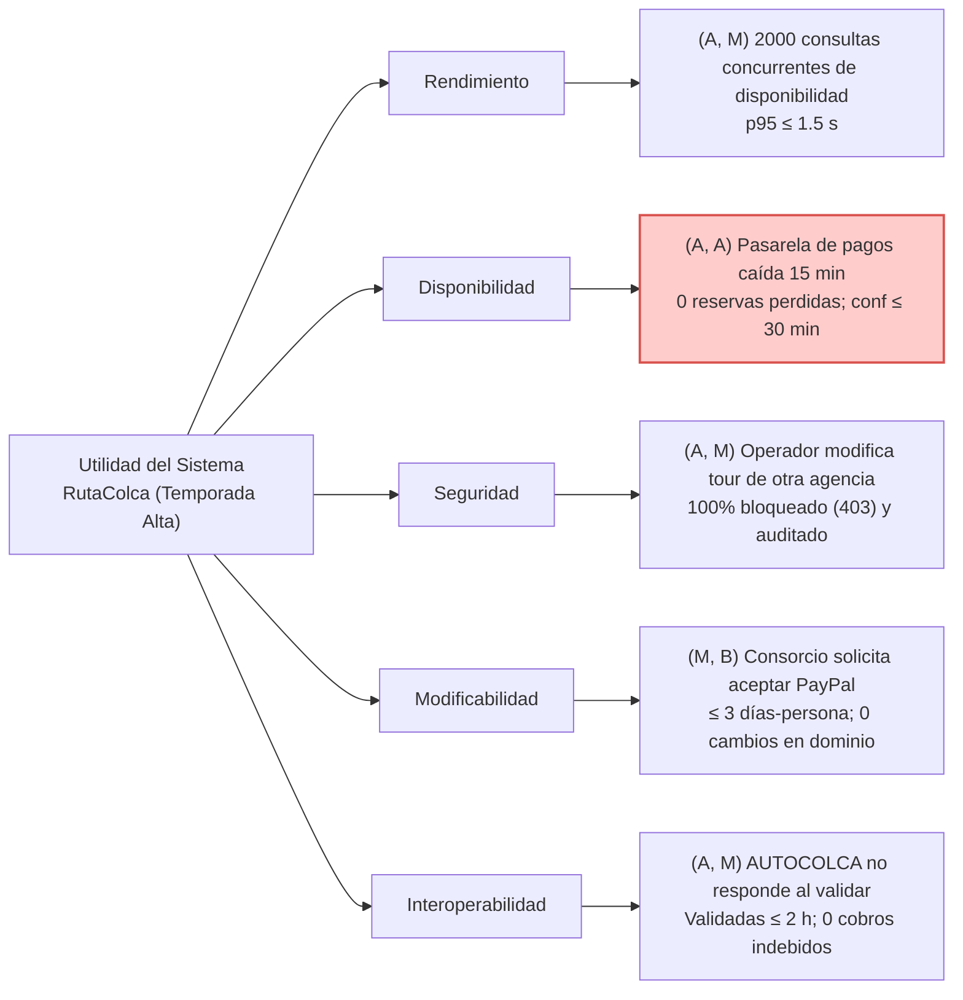

# Entregable E1: Árbol de Utilidad y Escenario Completo (AG-10)

**Curso:** Construcción de Software (1703243) – Semestre 2026-B  
**Docente:** Mg. Antonio Arroyo Paz  
**Facilitador ADD responsable:** Emanuel Hilacondo Begazo (`ehilacondob@unsa.edu.pe`)  
**Fecha:** 28 de octubre de 2026  
**Iteración:** ADD 3.0 – Temporada Alta de RutaColca (Julio)

---

## 1. Paso 1: Priorización con Árbol de Utilidad

Para guiar la iteración de diseño con el método **ADD 3.0 (Attribute-Driven Design)**, el equipo analizó los cinco escenarios de calidad del sistema RutaColca presentados en la guía de laboratorio, calificando cada uno según dos dimensiones:
- **Importancia para el negocio (I):** Alta (A), Media (M), Baja (B).
- **Dificultad técnica estimada con la arquitectura actual (D):** Alta (A), Media (M), Baja (B).

Los escenarios calificados como **(A, A)** representan los de mayor concentración de riesgo técnico y valor estratégico, debiendo abordarse prioritariamente en la primera iteración de arquitectura.

### Tabla 1. Árbol de utilidad de escenarios de calidad (Tabla 6 de la guía)

| Escenario | Atributo | Importancia (A/M/B) | Dificultad (A/M/B) | Justificación técnica y de negocio (una línea) |
| :---: | :---: | :---: | :---: | :--- |
| **E1** | **Rendimiento** | **A** | **M** | 2000 consultas simultáneas saturarían la API si no se introduce almacenamiento en caché en memoria y ajuste de réplicas. |
| **E2** | **Disponibilidad** | **A** | **A** | La pasarela externa no responde durante 15 min; al ser síncrona la arquitectura actual, se arriesgan pagos huérfanos y agotamiento de hilos. |
| **E3** | **Seguridad** | **A** | **M** | Un operador malicioso intenta alterar tours ajenos; requiere validación estricta de pertenencia (BOLA) y auditoría sin degradar latencia. |
| **E4** | **Modificabilidad** | **M** | **B** | Incorporar PayPal en $\le 3$ días-persona se resuelve mediante la infraestructura de adaptadores ya modularizada en el monolito. |
| **E5** | **Interoperabilidad** | **A** | **M** | La caída de AUTOCOLCA impide emitir boletos; requiere desacoplamiento temporal y conciliación diferida por lotes. |

### Diagrama del Árbol de Utilidad de RutaColca

> [!IMPORTANT]
> **Foco del diseño:** El escenario **E2 (Disponibilidad)** concentra la máxima prioridad arquitectónica **(A, A)**. Perder pagos confirmados destruye la reputación del consorcio turístico, provoca sobreventa de asientos en el Valle del Colca e introduce problemas contables y legales graves.

---

## 2. Paso 2: Especificación del Escenario E2 en Seis Partes

Conforme al estándar formal de escenarios de calidad de **Bass, Clements y Kazman (2021)**, el escenario asignado se desglosa rigurosamente en sus seis componentes canónicos para asegurar su verificabilidad empírica mediante pruebas y métricas cuantitativas:

### Tabla 2. Escenario completo de Disponibilidad (Tabla 7 de la guía)

| Parte del Escenario | Contenido del Grupo RutaColca | Justificación Técnica |
| :--- | :--- | :--- |
| **1. Fuente** | **Pasarela de Pagos Externa** (servicios de adquirencia como Niubiz, Izipay o API de PayPal). | Sistema de terceros fuera del control operativo y de infraestructura de la agencia. |
| **2. Estímulo** | **Corte del servicio o latencia infinita durante una ventana continua de hasta 15 minutos.** Las solicitudes HTTP retornan códigos `504 Gateway Timeout`, `502 Bad Gateway`, `503 Service Unavailable` o causan socket read timeout. | Simula la saturación típica que experimentan las redes bancarias en feriados de temporada alta (julio/agosto). |
| **3. Artefacto** | **Módulo de Pagos y Reservas en la API Backend (Spring Boot 3 / Java 21)** y las tablas transaccionales en la **Base de Datos Principal (PostgreSQL 16)**. | Componentes internos del monolito modular responsables de orquestar el cobro y persistir el estado de la reserva. |
| **4. Entorno** | **Operación en temporada alta (pico de demanda con carga $\times 10$).** Alta concurrencia de turistas nacionales y extranjeros intentando reservar simultáneamente antes de que se agoten los cupos. | El sistema no puede reiniciarse ni entrar en mantenimiento fuera de línea durante el incidente. |
| **5. Respuesta del Sistema** | 1. La API detecta tempranamente el fallo externo mediante un *circuit breaker* e interrumpe llamadas bloqueantes, evitando el agotamiento del pool de hilos de la JVM (*thread starvation*). 2. La reserva y su intención de pago se registran atómicamente en una tabla local de salida (*Transactional Outbox*) con estado diferido `PENDIENTE_PAGO`. 3. Se responde al turista de inmediato confirmando la recepción segura de su solicitud con un identificador de seguimiento, asegurando que no habrá cobros duplicados. 4. Cuando la pasarela restablece su servicio, un componente en segundo plano (*Outbox Relay Worker*) reintenta y concilia automáticamente las transacciones pendientes mediante reintentos con retroceso exponencial (*exponential backoff*). | Garantiza degradación grácil, experiencia de usuario sin fricción y consistencia transaccional eventual. |
| **6. Medida de Respuesta** | **1. 0 reservas pagadas perdidas** (cero pérdida de datos financieros). **2. Confirmación definitiva de la reserva $\le 30\text{ minutos}$** posteriores al restablecimiento operativo de la pasarela. **3. 0 cobros duplicados** ante reintentos de red. **4. Latencia percibida por el cliente $\le 1.2\text{ s}$** al registrar la solicitud diferida (evitando que el usuario espere los 15 minutos de corte). | Métricas 100% verificables mediante pruebas automatizadas y logs de auditoría. |

---

## 3. Conclusión del Facilitador ADD

El escenario **E2** ha quedado formalmente especificado y delimitado. Proporciona los criterios de éxito cuantitativos que gobernarán las decisiones de diseño arquitectónico en el **Paso 3 (Iteración de ADD)**, asegurando que cualquier táctica o patrón adoptado responda estrictamente a cumplir los objetivos de cero pérdida de pagos y recuperación en menos de 30 minutos sin infringir el presupuesto ni la restricción de monolito modular impuesta por el ADR-001.
